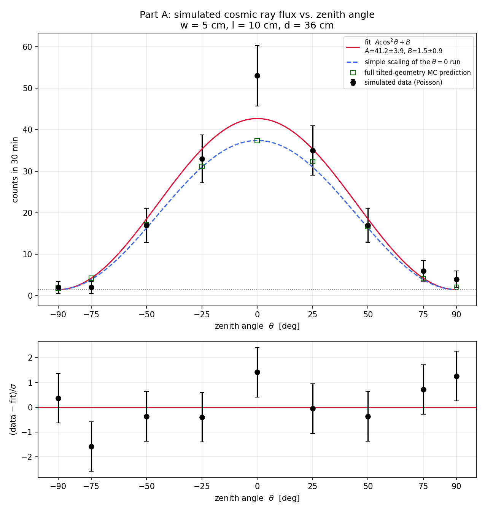
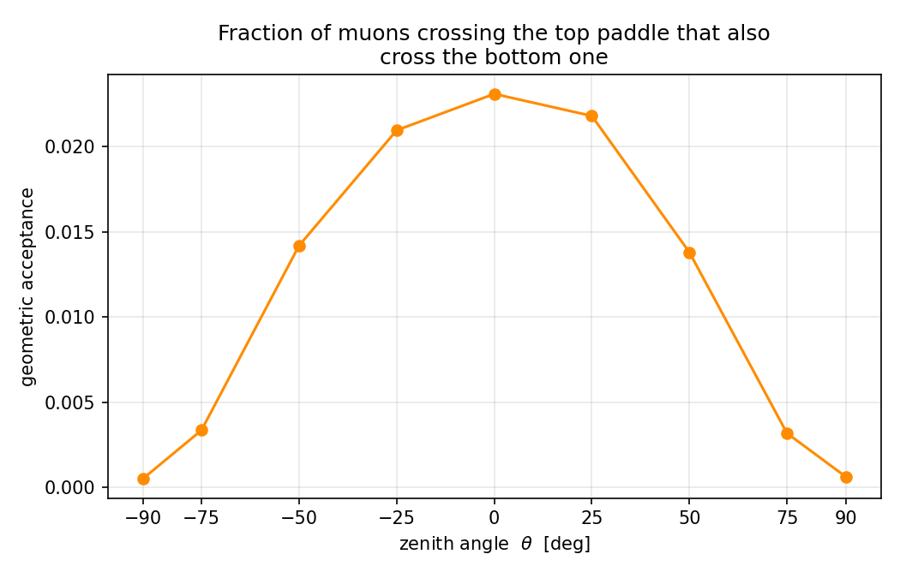

# Monte Carlo Simulation of a Cosmic Ray Muon Telescope

A Monte Carlo simulation of a two-paddle scintillator telescope that detects cosmic ray muons by coincidence. It predicts the detector's geometric acceptance and count rate, simulates the rate as the telescope is tilted from vertical to horizontal, generates realistic pseudo-data, and fits it to the expected $A\cos^2\theta + B$ angular distribution.

The code is a Python translation and extension of the C program `cosmic.c` from E. Harpell et al., *"The CCRT: an inexpensive cosmic ray muon detector,"* SLAC-TN-95-1 (1995).



## What it does

**Direct translation of `cosmic.c`.** The telescope is modeled as two identical rectangular paddles, one above the other. The program picks a random point on the top paddle, samples a muon direction from the $\cos^2\theta$ angular distribution using the inverse-transform method ($\cos\theta = R^{1/3}$), follows the straight track down to the bottom paddle, and counts it as a hit if it lands inside. The hit fraction is the detector's acceptance. This part reproduces the SLAC note's example as a cross-check.

**Tilted telescope.** The SLAC note leaves the tilted detector as an exercise; this program implements it. The detector axes are rotated by the tilt angle while the $\cos^2\theta$ flux stays defined relative to true vertical. Each track is weighted by $|\hat{p}\cdot\hat{n}|$, the projection of the track onto the paddle normal, so the program naturally captures both the $\cos^2$ fall-off and the deviations near the horizon, including tracks that cross the paddles in either direction when the telescope is horizontal.

**Pseudo-data and fitting.** For each angle, the predicted rate plus a constant background of accidental coincidences is turned into Poisson-fluctuated counts for a 30-minute run. The counts are fitted to $N(\theta) = A\cos^2\theta + B$ with `scipy.optimize.curve_fit`, and the program reports the fit parameters, uncertainties, $\chi^2$/ndf, and residuals. This mirrors the analysis applied to real detector data.

## A correction to the original code

`cosmic.c` counts accepted tracks with weight 1 after sampling directions from $\cos^2\theta$, but then multiplies by a top-paddle rate derived *with* the $\cos\theta$ projection factor. The flux crossing a flat paddle actually goes as $\cos^3\theta$, so the two halves of the calculation are inconsistent and the original code underestimates the coincidence rate.

For a telescope with 5 cm × 10 cm paddles separated by 36 cm:

| Method | Acceptance | Coincidence rate |
| --- | --- | --- |
| Original `cosmic.c` weighting | 0.0175 | 0.91 counts/min |
| Corrected $\cos^3\theta$ weighting | 0.0234 | 1.21 counts/min |
| Analytic estimate $J_0 (wl)^2/d^2$ | — | 1.27 counts/min |

With the corrected weighting, the Monte Carlo agrees with the simple analytic estimate to about 5%, as expected when the separation is much larger than the paddle size. The direct translation keeps the original weighting so the published numbers can still be reproduced.

## Usage

```bash
pip install -r requirements.txt
python MonteCarlo_Sim.py
```

It also runs directly in Spyder (press F5). The detector dimensions, tilt angles, number of simulated events, live time, and background rate are set at the top of the script. The random seed is fixed, so results are reproducible.

The program prints the cross-check, the vertical-rate comparison, a table of acceptance and rates at each angle, and the fit results. It saves three files to the current folder:

- `PartA_flux_vs_angle.png`: simulated counts, fit, predictions, and residuals
- `PartA_acceptance.png`: geometric acceptance versus tilt angle
- `PartA_simulated_data.csv`: the pseudo-data for further analysis

Example outputs are in [`results/`](results/).



## Physics inputs

- Vertical muon flux $J_0 = 0.66$ cm⁻² min⁻¹ sr⁻¹, with angular dependence $J(\theta) = J_0\cos^2\theta$ (SLAC-TN-95-1, eq. 2.2)
- Accidental coincidence background of 0.05 counts/min (adjustable)
- Straight-line muon tracks, with no scattering or detector inefficiency

## Reference

E. Harpell, W. Langeveld, D. McShurley, S. Shapiro, and J. Venuti, *"The CCRT: an inexpensive cosmic ray muon detector,"* SLAC-TN-95-1 (1995).
